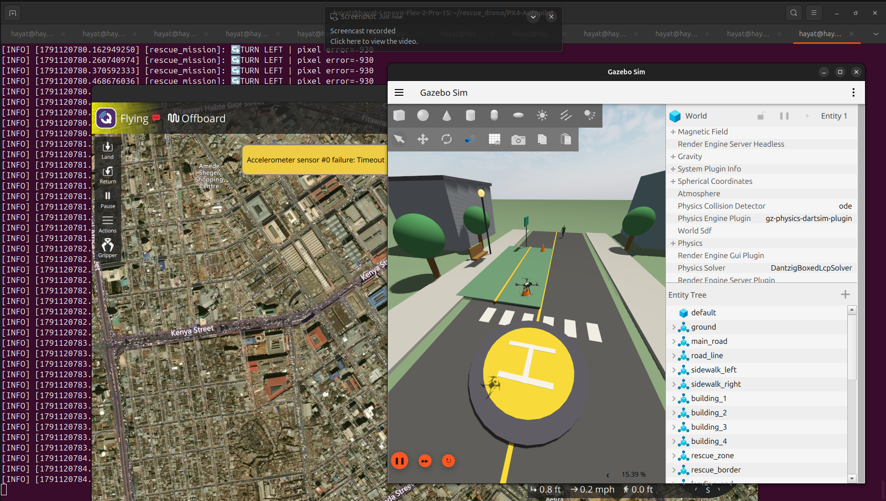

# 🚁 Autonomous AI Rescue Drone

An autonomous rescue-drone simulation built with **ROS 2, PX4, Gazebo, YOLO11, and depth perception**.

The drone uses computer vision to detect a person, estimates the person's distance using depth data, autonomously approaches the target, simulates emergency assistance, returns to its home position, and lands.

---

## 🎯 Project Goal

The goal is to simulate an autonomous drone capable of assisting a person during an emergency without manual piloting.

### Autonomous Mission

```text
SEARCH
   ↓
PERSON DETECTED
   ↓
DEPTH ESTIMATION
   ↓
APPROACH PERSON
   ↓
DELIVERY RANGE
   ↓
EMERGENCY PACKAGE DELIVERED
   ↓
RETURN HOME
   ↓
LAND
```

### 🧠 System Architecture

```              Gazebo
                │
          RGB + Depth Camera
                │
                ▼
             ROS 2
                │
        ┌───────┴────────┐
        ▼                ▼
      YOLO11        Depth Camera
        │                │
        ▼                ▼
 Person Detection   Distance Estimation
        │                │
        └───────┬────────┘
                ▼
       Rescue Mission Controller
                │
                ▼
               PX4
                │
                ▼
          Gazebo X500
```

## ✨ Features

### 👁️ Computer Vision

- YOLO11 person detection
- Real-time person localization
- Bounding-box visualization
- Person center estimation
- Detection confidence

### 📏 Depth Perception
- Depth camera integration
- Person-to-drone distance estimation
- RGB/depth coordinate mapping
- Real-time target distance

### 🚁 Autonomous Flight
- PX4 Offboard control
- Autonomous takeoff
- Person approach
- Target centering
- Delivery-range detection
- Simulated emergency package delivery
- Return-to-home
- Autonomous landing

## 🛠️ Technologies

| Technology | Purpose |
| :--- | :--- |
| **ROS 2 Jazzy** | Robotics middleware |
| **PX4** | Flight controller |
| **Gazebo Sim 8** | Drone simulation |
| **YOLO11** | Person detection |
| **Python** | AI and control |
| **OpenCV** | Computer vision |
| **cv_bridge** | ROS image processing |
| **ROS-Gazebo Bridge** | Sensor communication |
| **Micro XRCE-DDS** | PX4 ↔ ROS 2 communication |
| **QGroundControl** | Flight monitoring |


### 📂 Project Structure

```
autonomous-ai-rescue-drone/
│
├── ros2/
│   └── rescue_drone/
│       ├── rescue_drone/
│       │   ├── person_detector.py
│       │   ├── person_tracker.py
│       │   ├── person_distance.py
│       │   ├── depth_reader.py
│       │   ├── rescue_controller.py
│       │   ├── rescue_mission.py
│       │   └── ...
│       │
│       ├── package.xml
│       ├── setup.py
│       └── setup.cfg
│
├── models/
│
├── simulation/
│
├── rescue_world.sdf
├── README.md
└── .gitignore
```

## ⚙️ Environment

Tested on:

- Ubuntu 24.04
- ROS 2 Jazzy
- Gazebo Sim 8
- Python 3.12
- PX4 SITL
- CPU-based YOLO inference

## 🚀 Version 1 — Autonomous Rescue Mission

Version 1 is the project's baseline end-to-end rescue mission, tested in a simulated Gazebo environment. It combines person detection and depth-based distance estimation with PX4 Offboard control to guide the drone through the mission:

```text
Take off → Detect person → Estimate distance → Approach target
         → Simulate assistance → Return home → Land
```

Assistance is simulated; the project does not release a physical payload. Version 2 builds on this foundation with persistent person tracking and predictive target following.



## 🚁 Version 2 — Working Predictive Person Following

Version 2 is implemented and working in the Gazebo/PX4 simulation. Its ROS 2 nodes provide a predictive target-following pipeline:

```text
YOLO11 + ByteTrack
      ↓
Tracked person position
      ↓
Smoothed image-space velocity
      ↓
Short-horizon position prediction
      ↓
Depth-based 3D target estimate
      ↓
PX4 Offboard follow controller
      ↓
Return home and land
```

The V2 pipeline includes:

- YOLO11 person detection with persistent ByteTrack IDs
- Smoothed person-motion estimates and predicted image position
- Depth-based target distance estimation
- Conservative PX4 Offboard following in Gazebo
- Hovering when target data becomes stale
- Automatic return-to-home and landing after the follow test

The `rescue_brain_v2` node reports rescue decisions in dry-run mode. The separate `follow_flight_v2` node sends PX4 flight commands and is explicitly intended for simulation testing only. V2 demonstrates person following; it does not yet complete an integrated package-delivery rescue mission.

## 🧩 Why This Project?

This project combines several areas of robotics and AI:

Computer Vision + Depth Perception + ROS 2 + Autonomous Flight

Instead of manually controlling the drone, the system allows the drone to make decisions based on what its sensors see.

## 👨‍💻 Author

Hayat Ahmedjara

AI & Machine Learning Engineer

Addis Ababa, Ethiopia

Focus areas:

- Machine Learning
- Computer Vision
- Robotics
- LLM Engineering

## 📌 Project Status

### Version 1 — Completed ✅

Autonomous simulated rescue mission successfully demonstrated.

### Version 2 — Working in Simulation ✅

Predictive person tracking, depth-based target estimation, and PX4 Offboard following with return and landing are implemented for Gazebo/PX4 SITL. Real-world flight and an integrated package-delivery mission are not part of the current V2.
